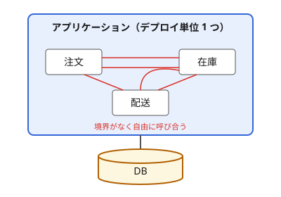
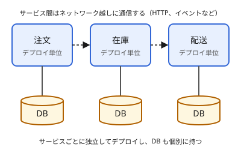
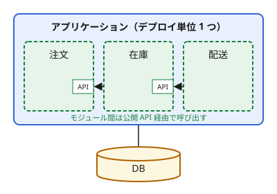

# デプロイアーキテクチャ

システム全体をどのような単位に分割し、どのようにデプロイするかに関するアーキテクチャパターン。

## 背景

システムとチームが小さいうちは、アプリケーション全体を 1 つの単位として開発・デプロイしても問題になりにくい。
しかし規模が大きくなると、システムをどのような単位に分割するかが、開発の進めやすさや運用に影響するようになる。

一方で、分割にはコストもある。細かく分けるほど良いわけではなく、どこまで分けるかはトレードオフになる。

主に以下の観点が、分割の単位を考えるうえで問題になる。

- チームの規模
- デプロイの頻度
- スケールの要件
- 分割のコスト

## モノリス

アプリケーション全体を 1 つのデプロイ単位として構築・デプロイする構成。
すべての機能が 1 つのコードベースとプロセスに含まれ、通常は 1 つの DB を共有する。

### 利点

#### 構成の単純さ

ビルド、テスト、デプロイの手順が 1 つで済み、監視や障害調査の対象も 1 つのアプリケーションに限られる。
機能間の呼び出しは関数呼び出しなので、ネットワーク通信による遅延や失敗を考えなくてよい。

#### データの整合性

すべてのデータが 1 つの DB にあるため、複数の機能にまたがる更新も 1 つのトランザクションで扱える。

### 課題

#### 依存関係の複雑化

コード上の境界が強制されないため、規模が大きくなると機能同士が自由に呼び合い、依存関係が絡み合う。
その結果、変更の影響範囲が読みにくくなり、意図しない副作用が起きやすくなる。

#### デプロイの遅さ

小さな変更でも、アプリケーション全体をビルド・テスト・デプロイし直す必要がある。
規模が大きくなるとビルドやテストに時間がかかり、デプロイの頻度を上げにくくなる。

#### 部分的なスケール

一部の機能に負荷が集中していても、アプリケーション全体を増やすしかない。
また、一部の不具合（メモリリークなど）がアプリケーション全体の停止につながる。

## マイクロサービス

機能ごとに独立したサービスに分割し、それぞれを個別にデプロイする構成。
サービス同士は HTTP やイベントなどを使ってネットワーク越しに通信し、各サービスは自分の DB を持つ。

### 利点

#### 独立したデプロイ

サービスごとにビルド・テスト・デプロイできるため、他のサービスを待たずにリリースできる。
サービスとチームを対応させれば、チームが開発から運用までを自律的に進められる。

#### 部分的なスケール

負荷が集中するサービスだけを増やせるため、リソースを効率よく使える。

#### 障害の分離

あるサービスが停止しても、適切に設計されていれば他のサービスは動き続けられる。

### 課題

#### ネットワーク越しの通信

サービス間の呼び出しがネットワーク越しになるため、遅延、タイムアウト、相手のサービスの停止への対処が必要になる。
また、他のサービスが使っている API を変更するときは、互換性を保つ必要がある。

#### データの整合性

サービスごとに DB が分かれているため、複数のサービスにまたがる更新を 1 つのトランザクションで扱えない。
[Saga パターン](5-event-driven-architecture.md#saga)などを使い、最終的に整合が取れる状態（結果整合性）を目指すことが多い。

#### 運用の基盤

多数のサービスを運用するために、自動デプロイ、監視、分散トレーシング、ログの集約などの基盤が必要になる。
ローカルでの開発環境やサービスをまたぐテストの構築も複雑になる。

#### 分散モノリス

サービスの境界は、DDD の Bounded Context に合わせて切るのが基本になる。
Bounded Context は、同じ用語やモデルが一貫した意味を持つ範囲のことで、範囲ごとに独立したドメインモデルを持つ。
Bounded Context ごとに独立したモデルとデータを持つという考え方が、サービスごとに DB を持つ設計につながっている。
Bounded Context を無視して、技術的な層やテーブルの単位でサービスを分けると、1 つの変更のために複数のサービスを同時に修正・デプロイしなければならなくなる。
このように、分割されているのにサービス同士が強く結合してしまった状態を分散モノリス（Distributed Monolith）と呼び、これはアンチパターンである。

## モジュラーモノリス

デプロイ単位は 1 つのまま、内部を独立性の高いモジュールに分割した構成。
各モジュールは公開 API を持ち、他のモジュールからは公開 API 経由でのみ呼び出せるようにする。

### 利点

#### 変更の影響範囲の限定

モジュールの内部は外から直接触れないため、変更の影響を公開 API の範囲に限定できる。
チームとモジュールを対応させれば、チーム間の調整も減らせる。

#### 運用の単純さ

デプロイ単位は 1 つなので、デプロイや監視の手順はモノリスと変わらない。
モジュール間の呼び出しもプロセス内で完結し、1 つの DB でトランザクションを扱える。

#### サービスへの切り出しやすさ

モジュールの境界と公開 API が明確なので、後から特定のモジュールをマイクロサービスとして切り出しやすい。

### 課題

#### 境界の維持

言語の機能や規約だけでは、他のモジュールの内部を直接呼び出すコードが入り込みやすい。
依存関係を静的解析で検査するなど、境界を仕組みで守らないと、元のモノリスに戻ってしまう。
DB を共有している場合は、他のモジュールのテーブルを直接参照することでも結合が生まれる。

#### デプロイ単位に起因する課題

デプロイ単位はモノリスと同じく 1 つなので、デプロイの遅さ、部分的なスケール、障害の波及といった課題は残る。

#### 境界の設計

モジュールの境界も、マイクロサービスのサービスと同じく Bounded Context に合わせて切ることが多い。
ただしドメインへの理解が浅いうちは Bounded Context を正しく見極めるのが難しく、境界を誤ると、変更のたびに複数のモジュールを直すことになる。

## 比較

## 歴史的経緯

2010 年代の初めごろ、Netflix などが、システムを小さなサービスに分割して大規模に運用する手法を実践し始めた。2014 年に James Lewis と Martin Fowler がこの手法を「マイクロサービス」として定義し、広く知られるようになった。この記事では、規模の大きくなったモノリスの課題として、小さな変更でも全体をビルド・デプロイし直す必要があること、時間とともにモジュール構造を保つのが難しくなること、一部だけをスケールできないことが挙げられている。

一方で、マイクロサービスには分散システム特有のコストがあることも指摘されるようになった。自動デプロイ、監視、障害への対処、結果整合性などが必要になり、チームの開発をかえって遅くすることがある。2015 年に Fowler は、マイクロサービスはシステムが十分に複雑な場合にだけ採用すべきで、そうでなければモジュール化したモノリスで構築すべきだと述べている。モノリスの問題の多くは、モノリスであること自体ではなく、モジュールの境界が守られていないことに起因するという考え方である。

この流れの中で、マイクロサービスに移行する代わりの選択肢として、モジュラーモノリスが注目されるようになった。よく知られた事例が Shopify である。Shopify では、Rails のモノリスが大きくなるにつれて、変更の副作用やビルド・テストの長時間化が問題になった。マイクロサービスも検討したが、分散システムの複雑さを理由に採用せず、2019 年にモジュラーモノリスへ移行したことを公表した。コードをビジネス上の機能単位で整理し直し、モジュール間の呼び出しを公開 API に限定して、その境界を仕組みで守るようにしている。

## 選定の考え方

### 小さく始める

Martin Fowler は MonolithFirst（2015 年）で、将来マイクロサービスが向いていそうなシステムでも、新しいアプリケーションはまずモノリスとして作るべきだと述べている。
経験のあるアーキテクトでも、最初から境界を正しく決めるのは非常に難しいためである。
この段階でサービスに分割すると、境界を誤って分散モノリスになりやすく、後から境界を引き直すコストも大きい。
モノリスであれば、境界の誤りはコードの修正で直せる。
Fowler は、API の境界とデータの保存の仕方の両方でモジュール性に注意してモノリスを設計しておけば、後からマイクロサービスに移行するのは比較的簡単になるとしている。

ただし、この考え方は一致した見解ではない。
Stefan Tilkov は Don't start with a monolith（2015 年）で、モノリスは時間とともに内部が絡み合い、後から分割するのが非常に難しくなると反論している。
ドメインを十分に理解しているなら、最初から独立した部分に分割して始めるべきだという主張である。

### 切り出しを検討するタイミング

Fowler は Microservice Premium（2015 年）で、マイクロサービスはシステムが十分に複雑な場合にだけ採用すべきだと述べている。
マイクロサービスには多数のサービスを管理するための固有のコストがあり、システムが単純なうちは、そのコストがかえって開発を遅らせるためである。
Shopify の例でも、長年うまく機能していたモノリスの欠点が利点を上回った時点で、アーキテクチャの見直しに着手している。

これらに従うと、マイクロサービスへの切り出しは、分割しないことによる問題が実際に起きてから検討することになる。
たとえば、以下のような状況である。

* チームが増え、同じコードベースでの変更の衝突や調整が、開発の妨げになっている
* 特定の機能だけ、負荷やデプロイの頻度の要件が他と大きく異なる
* 特定の機能の障害が、システム全体の停止につながることを避けたい

こうした問題がなければ、マイクロサービスの運用コストに見合う効果は得にくい。

### 段階的な移行

既存のモノリスをマイクロサービスに移行するとき、システム全体を一度に作り直すのはリスクが大きい。
作り直しが終わるまで新しい機能を出せず、移行の時点で問題が一斉に表面化するためである。

そのため、既存のシステムを動かしたまま、機能を 1 つずつ新しいサービスに置き換えていく方法がとられる。
まず、既存のシステムの一部の機能を新しいサービスとして作り、その機能へのリクエストを少しずつ新しいサービスに振り向ける。
新しいサービスが安定したら、既存のシステムから古い機能を削除する。
これを機能ごとに繰り返し、最終的に既存のシステムを置き換える。

この方法は、Martin Fowler によってストラングラーフィグパターンと名付けられている。
名前は、宿主の木に巻き付いて成長し、最終的に宿主を置き換えるイチジク（ストラングラーフィグ）に由来する。

この方法では、移行中もシステムを動かし続けながら、機能ごとに効果を確かめて進められる。
切り出す機能の境界がはっきりしているほど進めやすいため、MonolithFirst で述べられているように、モジュール性に注意してモノリスを設計しておくと移行しやすい。

### 運用の体制

マイクロサービスを選ぶ場合は、それを運用できる体制が整っていることが前提になる。
Fowler は Microservice Prerequisites（2014 年）で、最低限の前提条件として以下を挙げている。

* サーバーを数時間のうちに用意できること（環境構築の自動化）
* エラーやサービスの稼働状況に加え、注文数の減少のような業務上の異常も検知できる監視
* テスト環境や本番環境に素早くデプロイできること
* 開発者と運用担当者が密に協力する DevOps の文化

さらに、運用するサービスが増えてくると、サービスをまたぐ処理の追跡（分散トレーシング）なども必要になるとしている。

### コンウェイの法則

コンウェイの法則は、Melvin Conway が 1968 年に提唱した、「システムの構造は、それを設計する組織のコミュニケーション構造に似る」という経験則である。
たとえば、1 つのチームで開発すれば 1 つのまとまったシステムになりやすく、チームが分かれていればシステムもその単位で分かれやすい。

そのため、分割の単位は組織の分け方と合わせて考える必要がある。
チームの分け方とサービスやモジュールの境界が一致していないと、1 つの変更のために複数のチームの調整が必要になる。
逆に、目指すシステムの構造に合わせてチームのコミュニケーションの形を変えるという考え方もあり、逆コンウェイ戦略（Inverse Conway Maneuver）と呼ばれる。

## 参考

* [Microservices](https://martinfowler.com/articles/microservices.html)
* [Microservice Premium](https://martinfowler.com/bliki/MicroservicePremium.html)
* [MonolithFirst](https://martinfowler.com/bliki/MonolithFirst.html)
* [Don't start with a monolith](https://martinfowler.com/articles/dont-start-monolith.html)
* [Microservice Prerequisites](https://martinfowler.com/bliki/MicroservicePrerequisites.html)
* [Bounded Context](https://martinfowler.com/bliki/BoundedContext.html)
* [Strangler Fig](https://martinfowler.com/bliki/StranglerFigApplication.html)
* [Conway's Law](https://martinfowler.com/bliki/ConwaysLaw.html)
* [Deconstructing the Monolith](https://shopify.engineering/deconstructing-monolith-designing-software-maximizes-developer-productivity)
* [マイクロサービス移行の代償](https://www.infoq.com/jp/news/2015/06/microservices-premium/)
* [Shopifyはいかにしてモジュラモノリスへ移行したか](https://www.infoq.com/jp/news/2019/10/shopify-modular-monolith/)
- [モノリス・マイクロサービスの違いとモダナイゼーションについて](https://qiita.com/k12da/items/8ef4fc446425a057f7da)
